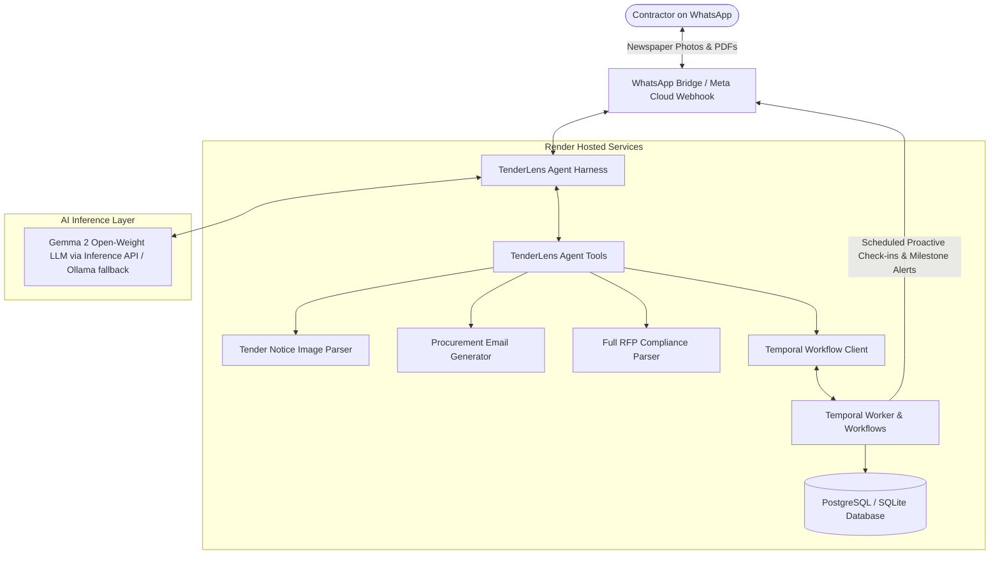

# TenderLens T&T 🇹🇹
> **Open-Source AI Tender Readiness & Proactive Follow-Through Assistant for Contractors**  
> *Built for Hacktoberfest 2026 Open-Source AI Challenge: Week 2 (Side Hustle)*

[](#testing)
[](#hacktoberfest-week-2)
[-blue.svg)](#architecture)
[](#architecture)
[](#deployment-on-render)

---

## 💡 The Problem
In Trinidad & Tobago (and across the Caribbean), public procurement opportunities under the *Public Procurement and Disposal of Public Property Act* are high-stakes. Small and medium contractors frequently get disqualified or miss out entirely—not because their prices or skills aren't competitive, but because of **administrative technicalities and blown deadlines**:
1. **The True Starting Point**: Tenders are first seen as printed newspaper notices (Trinidad Guardian, Express, Newsday) or social media clippings. Bidders must act quickly to request documents via ERP/email before cut-offs.
2. **Hidden Critical Path Bottlenecks**: In Trinidad & Tobago, obtaining a **Board of Inland Revenue (BIR) Tax Clearance** or **VAT Clearance** takes **5–10 business days**, and **National Insurance Board (NIS)** compliance takes **3–5 business days**. If a contractor waits until the last week, it is already too late.
3. **Mandatory Site Visit Clauses**: Procuring entities (such as WASA, UDeCOTT, NIPDEC) routinely require bidders to formally register representatives **at least two (2) business days prior** to mandatory site visits. Missing the pre-bid visit results in immediate disqualification.

**TenderLens solves this.** It isn't just a document summarizer; it is an active follow-through agent that turns tender requirements into a living bid plan, schedules proactive WhatsApp reminders, and keeps the contractor on track until final submission.

---

## 🚀 Key Features

- **📸 Stage 1: Newspaper Notice / Ad Ingestion**
  - Contractor snaps a photo of a newspaper tender clipping on WhatsApp.
  - TenderLens extracts the authority (e.g. WASA), tender ref (`W.T.C. - 40/2026`), title, closing date, and mandatory site visit dates.
  - Automatically drafts the formal procurement package request email addressed to the entity (e.g., `purchasingandstores@wasa.gov.tt` for Oracle ERP access).
- **📋 Stage 2: Full RFP Compliance Matrix**
  - Ingests full 50–100 page procurement packages (PDF, DOCX, or multi-file ZIP bundles).
  - Automatically isolates mandatory statutory items (BIR, NIS, VAT), corporate records (Form 4/28), Bid Security/Tender Bonds, and technical requirements with **exact page citations**.
- **⏰ Stage 3: Proactive Temporal Follow-Through**
  - Powered by **Temporal durable workflows** (`TenderFollowThroughWorkflow`), surviving server restarts and network dropouts.
  - Automatically checks in with the contractor over WhatsApp (e.g., checking on BIR clearance progress 7 days before submission).
  - Prompts for quick one-tap replies: *"Done"*, *"Still waiting on IRD"*, or *"Need help"*.
- **🌐 Stage 4: Multi-Channel Ingestion & WhatsApp Gateways**
  - Direct WhatsApp document forwarding (supporting up to WhatsApp's 100 MB API limit).
  - Magic Web Upload portal (`/upload/{tender_id}`) for multi-file tender bundles, drawings, and bills of quantities.

---

## 🏗️ Architecture



---

## 🏆 Hacktoberfest Week 2 Tracks & Alignment

| Category | Track Type | How TenderLens Qualifies |
|---|---|---|
| **Side Hustle (Main Theme)** | Prompt | Built as a paid B2B service for contractors (TT$300–600 per tender readiness tracking). Open-source AI at its core. |
| **Best Use of Render** | Featured ($200) | Full infrastructure blueprint (`render.yaml`) orchestrating a FastAPI Web Gateway, Temporal Background Worker, and Managed PostgreSQL. |
| **Best Use of Gemma** | Featured ($200) | Powered by Google's **Gemma 2** (9B / 27B) open-weight model for document extraction, clause analysis, and conversational follow-through. |
| **Best Use of Temporal** | Partner ($100) | Orchestrates durable, multi-week tender follow-through workflows with timers, signals (`signal_update_task`), and queries (`query_status`). |

---

## 🛠️ Quickstart & Local Testing

### 1. Installation
```bash
# Clone repository
git clone https://github.com/AnthonyASBaptiste/tenderlens.git
cd tenderlens

# Create virtual environment and install dependencies
uv venv --python 3.13 .venv
source .venv/bin/activate
uv pip install -e ".[dev]"
```

### 2. Run Automated Test Suite
```bash
pytest -v
```

### 3. Run the Interactive WhatsApp Simulator
Experience the complete contractor journey (ad photo -> email draft -> proactive follow-up -> full RFP ingestion -> checklist update):
```bash
python -m src.tenderlens.gateway.interactive_cli
```

### 4. Launch the Web Gateway & Web WhatsApp Simulator
```bash
uvicorn src.tenderlens.gateway.app:app --reload --port 8000
```
- **Web WhatsApp Simulator (For Judges & Instant Demos)**: Open `http://localhost:8000/` or `http://localhost:8000/demo` in any browser to experience the mobile WhatsApp UI with 1-click test buttons.
- **Secure Magic Upload**: Open `http://localhost:8000/upload/tender_wtc___40_2026?token=dev` to test the HMAC-protected drag-and-drop dropzone for bundles >100MB.
- **Health Endpoint**: `http://localhost:8000/health`.

---

## 📦 Deployment on Render

This project is configured as a Render Blueprint in [`render.yaml`](render.yaml):
1. Connect your GitHub repository to [Render](https://render.com).
2. Create a new **Blueprint** and select this repository.
3. Render automatically provisions:
   - `tenderlens-api`: FastAPI Web Gateway with `/health` and WhatsApp webhook support.
   - `tenderlens-temporal-worker`: Dedicated background worker running durable follow-up workflows.
   - `tenderlens-db`: Managed PostgreSQL database.

---

## 📄 License
MIT License. Built with ❤️ in Trinidad & Tobago for Hacktoberfest 2026.
